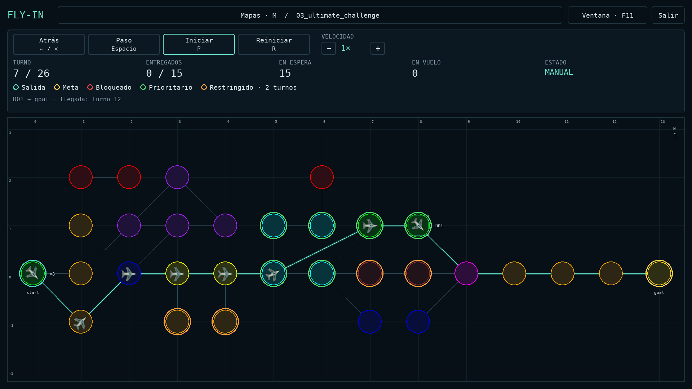
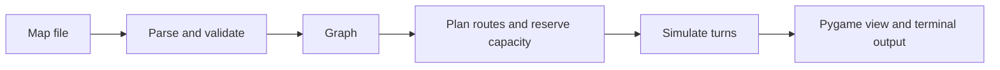

# Fly-In: Drone Traffic Simulator

Plan and visualize a fleet of drones moving through a network of hubs with limited capacity. Fly-In reads a map, schedules each drone's route turn by turn, and plays the result in a tactical Pygame interface.



*The Ultimate Challenge map at turn 7, with one drone's planned route selected.*

The challenge is to deliver every drone in as few turns as possible while respecting hub occupancy, shared connection capacity, and the extra travel time required by restricted zones. Drones can take different paths, move simultaneously, or wait for space to open up.

## Interactive features

- **Fullscreen map library:** browse maps by difficulty and switch scenarios without restarting the application.
- **Playback controls:** step forward, go back, play/pause, restart, and choose a speed from 0.25× to 4× using buttons or keyboard shortcuts.
- **Fleet overview:** track the current turn, delivered drones, waiting drones, and flights in transit.
- **Route inspection:** select a drone to highlight its itinerary; hover over drones and hubs for details.
- **Adaptive map view:** preserve map proportions when resizing, with space for hub rings and labels and a readable zone legend.
- **Custom maps:** add your own TXT files to the map library; validation errors appear in the interface without replacing the current simulation.

## Try it

Requires Python 3.13 or later, [uv](https://docs.astral.sh/uv/), Make, and a graphical desktop. From the project root:

```sh
make install
make run
```

`make install` creates a local `.venv` from the committed `uv.lock`; no manual activation is needed. `make run` opens the fullscreen map library. Choose any `.txt` file from `maps/`, grouped by difficulty, with a click or the arrow keys and Enter. Scroll to see more maps. To open a map directly, use `make run MAP=maps/hard/03_ultimate_challenge.txt` or `uv run python main.py path/to/map.txt`.

Each map starts in manual mode at turn zero. Press **Space** to advance one turn, **Left arrow** to go back one turn, **R** to restart from turn zero, or **P** to start automatic playback. Each completed turn prints its drone movements to the terminal.

| Control | Action |
| --- | --- |
| **Space** | Advance one turn; during automatic playback, switch to a single manual step. |
| **Left arrow**, **<** or **>** | Go back one completed turn. This also works during playback or after delivery. |
| **R** | Restart from turn zero, including after the simulation finishes. |
| **P** | Start or pause automatic playback. |
| **+ / −** | Increase or decrease playback speed between 0.25× and 4×. |
| Panel buttons | Go back, advance one turn, play/pause, restart, or change speed. |
| Click a drone | Select it and highlight its planned route. Click the group again to select another drone. |
| Hover over a drone or hub | Inspect flight IDs or hub details. |
| **M** / Maps button | Open the map library; the current simulation freezes while browsing. |
| **F11** | Toggle fullscreen/windowed mode without losing playback state. |
| **Esc** | Close the library and return to the current simulation, or exit when no map is open. Outside the library, exit. |
| Exit button / close window | Exit. |

Loading another map resets playback, speed, and selection. Invalid maps show an error in the library and leave the previous simulation available.

The map uses its own coordinates. Colored rings identify zone types, moving sprites show flights, and the operations panel reports the turn, deliveries, waiting drones, and flights in transit. A restricted flight remains visible on its connection for the extra turn.

## Add your own map

1. Create a `.txt` file following the [map format below](#map-format-and-turn-output), for example `maps/easy/my_first_map.txt`.
2. Open the map library with **M**. If it is already open, close it and reopen it to refresh the list.
3. Select your file to validate it, plan the routes, and start at turn zero.

The library discovers `.txt` files recursively under `maps/`; the included ten maps are examples, not a fixed list. The folder determines the displayed difficulty group, rather than an automatic difficulty assessment.

Invalid files remain visible. Validation happens when you load a map: if parsing, validation, or route discovery fails, the library displays the error and keeps your previous simulation. Close the library to return to it, or correct the file and try loading it again.

## How it works



The parser uses Lark for the map syntax and Pydantic for validation. The graph stores hubs and bidirectional connections in adjacency lists. A static Dijkstra search first checks whether a route exists without passing through blocked hubs.

The planner then schedules drones one at a time. It searches states of the form `(hub, turn)`: where a drone will be **after** a turn. From a state, the drone can enter a neighboring hub or wait. Each move must fit the destination's capacity at arrival and the connection's capacity on every travel turn. The chosen itinerary is reserved before the next drone is planned. Connection capacity is shared across both travel directions; start and goal have unlimited hub occupancy.

Search favors earlier arrival, then fewer movements. Priority zones break remaining queue ties. This produces the earliest feasible arrival for each drone under existing reservations, but earlier plans are not reconsidered: the combined schedule is **not guaranteed to be globally optimal**. The simulation plays the finished itineraries without searching again on every frame.

| Zone | Entry behavior |
| --- | --- |
| `normal` | One turn. |
| `priority` | One turn; preferred when search priorities tie. |
| `restricted` | Two turns, occupying the connection during both. |
| `blocked` | Cannot be entered. |

For example, a drone leaving at the end of turn 2 for a restricted hub arrives at the end of turn 4. Its connection needs space during turns 3 and 4, and its destination needs space at turn 4.

## Results on the included maps

The current planner completes every included map within the reference targets in the project brief. Turn counts describe the complete fleet, not an individual drone.

| Map | Drones | Turns | Reference target |
| --- | ---: | ---: | ---: |
| Easy · Linear path | 2 | 4 | ≤ 6 |
| Easy · Simple fork | 4 | 4 | ≤ 8 |
| Easy · Basic capacity | 4 | 4 | ≤ 6 |
| Medium · Dead end trap | 5 | 8 | ≤ 12 |
| Medium · Circular loop | 6 | 15 | ≤ 15 |
| Medium · Priority puzzle | 5 | 7 | ≤ 12 |
| Hard · Maze nightmare | 8 | 13 | ≤ 30 |
| Hard · Capacity hell | 12 | 16 | ≤ 35 |
| Hard · Ultimate challenge | 15 | 26 | ≤ 45 |
| Challenger · The Impossible Dream | 25 | **43** | 45-turn reference |

These counts were checked against the maps in this repository. They are not a claim of optimality on other maps.

## Map format and turn output

The smallest included example, [`maps/easy/01_linear_path.txt`](maps/easy/01_linear_path.txt), contains:

```text
nb_drones: 2

start_hub: start 0 0 [color=green]
hub: waypoint1 1 0 [color=blue]
hub: waypoint2 2 0 [color=blue]
end_hub: goal 3 0 [color=red]

connection: start-waypoint1
connection: waypoint1-waypoint2
connection: waypoint2-goal
```

Advancing its four turns prints:

```text
D1-waypoint1
D1-waypoint2 D2-waypoint1
D1-goal D2-waypoint2
D2-goal
```

Each line represents one turn. Waiting drones and drones delivered on earlier turns are omitted. A drone still crossing a restricted connection is printed with that connection's endpoints.

Hubs may specify `zone`, `color`, and `max_drones`; connections may specify `max_link_capacity`. Both capacities default to one. Comments start with `#`. Explore more examples in the [maps directory](maps/README.md).

## Development

| Command | Purpose |
| --- | --- |
| `make run` | Open the fullscreen map library. |
| `make run MAP=path/to/map.txt` | Run a selected map. |
| `make debug MAP=path/to/map.txt` | Start the program in Python's debugger. |
| `make lint` | Run Flake8 and mypy. |
| `make lint-strict` | Run Flake8 and mypy in strict mode. |
| `uv run python -m unittest discover -s tests` | Run schedule, validation, playback, map library, and viewport tests without a graphical desktop. |
| `make clean` | Remove the local environment and tool caches. |

The code is organized into `parser/`, `graph/`, `planner/`, `simulation/`, and `renderer/`. The application shell handles map discovery and window navigation; `map_loader.py` validates and plans a fresh simulation before replacing the current view. Map errors appear in the library. Graphics and command-line usage errors go to standard error and return `1`; normal exit returns `0`, and Ctrl+C returns `130`.

## Author

**Arnau Corominas Perez** · `acoromin`

## Resources and credits

This project was created as part of the 42 curriculum by Arnau Corominas Perez (`acoromin`). The planning approach and interface were developed for this project; it does not use a graph library.

- [Python `heapq` documentation](https://docs.python.org/3/library/heapq.html) — priority queues for route searches.
- [Lark documentation](https://lark-parser.readthedocs.io/en/stable/) — parsing the map grammar.
- [Pydantic documentation](https://docs.pydantic.dev/latest/) — validating map data.
- [Pygame documentation](https://www.pygame.org/docs/) — drawing, events, and animation.
- [uv project guide](https://docs.astral.sh/uv/guides/projects/) — dependency and lockfile management.

AI assisted with discussions of pathfinding and capacity rules, reviews of parsing and simulation behavior, the tactical renderer, and final integration. It also helped prepare the entry point, movement output, uv configuration, Makefile, English docstrings, and this README.
